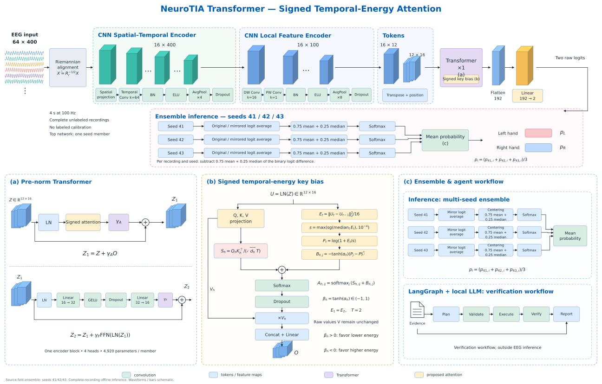
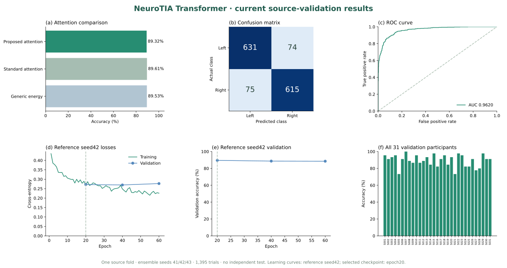
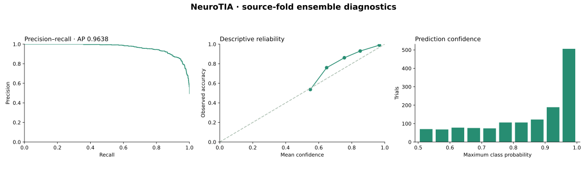

# NeuroTIA Transformer

**GitHub Pages dashboard (enable Pages below):** [NeuroTIA](https://polashdas040.github.io/NeuroTIA/) — no installation or local server required.

**Motor-imagery EEG classification with signed temporal-energy attention and a local LLM evidence workflow.**

NeuroTIA uses a compact CNN–Transformer hybrid to classify imagined left-hand versus right-hand movement from 64-channel EEG. Its CNN feature encoder applies spatial–temporal and depthwise/pointwise convolutions to produce tokens for the Transformer classifier. The proposed attention adds a learned, signed bias based on adjacent-token energy. A separate LangGraph workflow retrieves local records, plans verification with a local LLM, runs numerical checks, and reports findings. The LLM does not classify EEG.



## Results

These are **source-validation results on one fold: 31 participants and 1,395 trials**, with the participants excluded from both execution pretraining and imagery fine-tuning. The current ensembles average seeds **41, 42 and 43**. Settings were selected previously on this same fold using seed42. This is **not independent testing or completed three-fold cross-validation**.

| Model | Correct / trials | Accuracy | Balanced accuracy | Macro F1 | ROC AUC | Cross-entropy |
| --- | --- | --- | --- | --- | --- | --- |
| Proposed signed-energy attention | 1,246/1,395 | 89.32% | 89.32% | 89.32% | 0.9620 | 0.2662 |
| Standard attention | 1,250/1,395 | 89.61% | 89.60% | 89.60% | 0.9624 | 0.2653 |
| Generic energy control | 1,249/1,395 | 89.53% | 89.54% | 89.53% | 0.9630 | 0.2649 |

The proposed ensemble scores **89.32%**, **-0.29 percentage points** relative to standard attention. It does not outperform the standard control in this ensemble comparison. Proposed average precision is **0.9638** and Brier score is **0.0802**. There are **149 errors**. These measurements do not establish a general attention advantage, physiological interpretation, clinical utility or scientific novelty.

The earlier single-seed42 comparison was 89.53% (1,249/1,395) proposed versus 89.25% (1,245/1,395) for each control. It is provided as context, not substituted for the requested three-seed result.



### Classification metrics

| Class / average | Precision | Recall | F1 | Support |
| --- | --- | --- | --- | --- |
| Left imagery | 89.38% | 89.50% | 89.44% | 705 |
| Right imagery | 89.26% | 89.13% | 89.20% | 690 |
| macro avg | 89.32% | 89.32% | 89.32% | 1,395 |
| weighted avg | 89.32% | 89.32% | 89.32% | 1,395 |

Confusion matrix (rows actual, columns predicted):

| Actual / predicted | Left imagery | Right imagery |
| --- | --- | --- |
| Left imagery | 631 | 74 |
| Right imagery | 75 | 615 |

Class 0 is left imagery and class 1 is right imagery. ROC and precision–recall use right imagery as positive.

### Learning curves and probability diagnostics

The figure's learning curves are for **reference member seed42**, not for the aggregate ensemble. Training loss was recorded every epoch; participant-mean validation cross-entropy and validation accuracy were recorded at epochs 20, 40 and 60. The selected checkpoint is epoch20; later points describe continued training, not the exported model. Training loss includes augmentation, so it is not measured under the same conditions as validation loss. **Test loss/accuracy curves and training accuracy were not recorded.**



Reliability is descriptive on this selected source fold, not evidence of out-of-sample calibration. Confidence is the maximum predicted class probability. The interactive dashboard also provides model selection, participant search/sorting, exact graph values and CSV export.

### Every participant, accounted for

All 31 participants in the source fold are included below. The three comparison columns use the same trials.

| Participant | Trials | Proposed correct | Proposed accuracy | Proposed AUC | Standard accuracy | Generic accuracy |
| --- | --- | --- | --- | --- | --- | --- |
| S001 | 45 | 43 | 95.56% | 0.9980 | 95.56% | 95.56% |
| S002 | 45 | 41 | 91.11% | 0.9783 | 91.11% | 91.11% |
| S003 | 45 | 42 | 93.33% | 0.9881 | 93.33% | 93.33% |
| S004 | 45 | 43 | 95.56% | 0.9881 | 95.56% | 93.33% |
| S005 | 45 | 33 | 73.33% | 0.8274 | 73.33% | 73.33% |
| S006 | 45 | 41 | 91.11% | 0.9782 | 93.33% | 93.33% |
| S007 | 45 | 45 | 100.00% | 1.0000 | 100.00% | 100.00% |
| S008 | 45 | 40 | 88.89% | 0.9545 | 88.89% | 86.67% |
| S009 | 45 | 39 | 86.67% | 0.9325 | 84.44% | 84.44% |
| S010 | 45 | 43 | 95.56% | 0.9683 | 95.56% | 95.56% |
| S011 | 45 | 39 | 86.67% | 0.9051 | 86.67% | 86.67% |
| S012 | 45 | 40 | 88.89% | 0.9881 | 91.11% | 91.11% |
| S013 | 45 | 42 | 93.33% | 0.9822 | 93.33% | 93.33% |
| S014 | 45 | 38 | 84.44% | 0.9150 | 86.67% | 86.67% |
| S015 | 45 | 44 | 97.78% | 1.0000 | 100.00% | 100.00% |
| S016 | 45 | 37 | 82.22% | 0.9032 | 84.44% | 84.44% |
| S017 | 45 | 41 | 91.11% | 0.9723 | 91.11% | 91.11% |
| S018 | 45 | 43 | 95.56% | 0.9980 | 95.56% | 97.78% |
| S019 | 45 | 38 | 84.44% | 0.9625 | 84.44% | 84.44% |
| S020 | 45 | 42 | 93.33% | 0.9881 | 95.56% | 93.33% |
| S021 | 45 | 33 | 73.33% | 0.7381 | 73.33% | 73.33% |
| S022 | 45 | 44 | 97.78% | 1.0000 | 97.78% | 97.78% |
| S023 | 45 | 43 | 95.56% | 0.9625 | 95.56% | 95.56% |
| S024 | 45 | 37 | 82.22% | 0.9190 | 80.00% | 82.22% |
| S025 | 45 | 37 | 82.22% | 0.9269 | 82.22% | 80.00% |
| S026 | 45 | 41 | 91.11% | 0.9881 | 93.33% | 93.33% |
| S027 | 45 | 35 | 77.78% | 0.8557 | 77.78% | 77.78% |
| S028 | 45 | 36 | 80.00% | 0.9150 | 77.78% | 80.00% |
| S029 | 45 | 44 | 97.78% | 1.0000 | 97.78% | 97.78% |
| S030 | 45 | 41 | 91.11% | 0.9861 | 91.11% | 91.11% |
| S031 | 45 | 41 | 91.11% | 0.9822 | 91.11% | 91.11% |

## Install and run

Requirements: **Python 3.12**, **Node.js 18+** for the dashboard, and the Python dependencies pinned in `requirements.txt`. No npm packages are needed. CPU inference is supported.

```bash
git clone https://github.com/polashdas040/NeuroTIA.git
cd NeuroTIA
python -m venv .venv
```

Activate the environment:

```powershell
# Windows PowerShell
.venv\Scripts\Activate.ps1
```

```bash
# Linux / macOS
source .venv/bin/activate
```

Install and verify the included checkpoints and saved measurements:

```bash
python -m pip install -r requirements.txt
python -m model.verify_current
```

Verification checks file hashes, loads all nine checkpoints (three variants × three seeds), reconciles accuracies from aggregate confusion matrices and participant counts. It does not download EEG or run new raw EEG inference. The exported models were also replayed against their original aligned source EEG with exact agreement for all 12,555 member-trial probability vectors.

### Open the dashboard

```bash
node web_ui/server.js
```

After enabling GitHub Pages, view the dashboard at **[NeuroTIA](https://polashdas040.github.io/NeuroTIA/)**. For optional local development, keep the server terminal running. The dashboard reads the included results; raw EEG, an API key and an LLM service are not required to view it. Opening it does not train models or make LLM calls. Recorded agent outputs concern the earlier seed42 verification snapshot and are labeled accordingly.

### Publish with GitHub Pages

The `docs/` folder contains the static HTML/CSS/JavaScript dashboard, aggregate results and architecture assets. No dataset or Node.js server is required by visitors.

1. Open repository **Settings → Pages**.
2. Set **Source** to **Deploy from a branch**.
3. Select **main** and **/docs**, then click **Save**.
4. After GitHub finishes deployment, open [NeuroTIA](https://polashdas040.github.io/NeuroTIA/).

### Classify your own recording

Obtain compatible EEG from the PhysioNet dataset, using complete left/right imagery recordings (runs 04/08/12). For example, after downloading `S073R04.edf` locally:

```bash
python -m model.preprocess S073R04.edf --output input.npz
python -m model.predict_current input.npz predictions.npz --complete-recordings
```

The default is the proposed 41/42/43 ensemble. Add `--variant standard` or `--variant generic` to run the matched control ensembles. Inputs and outputs must use new paths; existing outputs are not overwritten.

Prepared NPZ keys are `x` (finite float32 N × 64 × 400), `channels` in `model/channels.json` order, `recording_id`, and unique `trial_id`. Do not align inputs twice: the predictor performs alignment. Input labels are not read. Output includes probabilities, predicted class, trial/recording IDs, variant and seeds. Complete offline recording batches are required, with no labeled calibration. Results do not establish causal streaming, single-trial or other-device performance.

### Run the local LLM workflow

This is optional for classification and the dashboard. Install Ollama separately, start its local service, and obtain the configured model:

```bash
ollama pull qwen3:1.7b
python -m agent.current_workflow --output runs/evidence_review
```

The output directory must be new. `agent/llm_config.json` defaults to the local Ollama endpoint at `http://127.0.0.1:11434`. No cloud LLM key is required. The LangGraph stages are:

1. Retrieve local protocol/comparison/limitation records and call the LLM to plan checks.
2. Validate model/evidence hashes.
3. Recompute Python accuracy and counts from aggregate confusion matrices and participant counts.
4. Verify trial identity, measurements and evaluation scope.
5. Call the LLM to report the verified evidence.

Outputs include retrieved evidence, actual LLM request/response receipts, a five-stage trace and numerical verification. LLM statements are commentary and can contain errors; numeric checks are authoritative. No LLM accuracy benefit has been tested.

## Architecture and training protocol

The full source pool contains 91 participants, 4,095 imagery trials and 4,098 executed-movement trials. This fold uses 60 training participants and excludes all 31 validation participants from both stages. Shared standard-attention execution pretraining runs for 40 epochs; selected imagery fine-tuning runs for 20 epochs. Each model has 4,920 parameters, or 14,760 per three-member ensemble.

Preprocessing: 50 Hz notch, 4–38 Hz zero-phase filtering, common-average reference, 100 Hz resampling, four-second epochs, recording normalization and unlabeled per-recording OAS/Riemannian alignment. The CNN feature encoder uses spatial/temporal, depthwise and pointwise convolutions to produce twelve 16-dimensional tokens. A single pre-norm Transformer uses four heads, a 16–32–16 feed-forward sublayer and a flattened 192–2 classifier.

For normalized tokens U, the proposed attention is:

```text
E_t = mean_features((U_t - U_(t-1))²), t=2,...,12; E_1=E_2
s = max(stop_gradient(median_time(E)), 1e-4)
P_t = log(1 + E_t/s)
B_(h,j) = -tanh(alpha_h) [P_j - mean_time(P)]
A_h = softmax_keys(Q_h K_h^T / (sqrt(4) T) + B_h)
O_h = Dropout(A_h) V_h
```

Both bias variants use T=2. Standard attention searches T=0.5/1/2, and each bias variant searches alpha initialization −1/0/1, with the same three-configuration and 20/40/60-epoch budgets. Selected proposed initialization is −1; control configurations are in the manifest. Signed coefficients may favor higher or lower token energy. Values remain unchanged. Token energy is a latent variation proxy, not measured connectivity, calibrated uncertainty or a validated artifact detector.

Inference averages original and mirrored class-swapped logits, subtracts 0.75 recording mean plus 0.25 recording median of the binary logit difference before softmax, then averages seed probabilities. This fixed rule is shared by the controls.

## Files and reproducibility

```text
model/       Architecture, nine checkpoints, preprocessing, inference and verification
agent/       Local Ollama client and LangGraph evidence workflow
results/     Aggregate metrics, histories and plotting scripts
figures/     Architecture as SVG; results as SVG/PDF, plus drawing source
web_ui/      HTML/CSS/JavaScript dashboard and Node server
README.md
requirements.txt
```

Only these runnable files and compact scientific records are included. Raw EEG, virtual environments, private experiments, local archives, secrets and logs are excluded. This release supports frozen-model inference, aggregate-result verification and figure regeneration; it is not a complete raw-data retraining distribution.

```bash
python results/plot_current_results.py
python figures/draw_current_architecture.py
```

Graphs use published aggregate measurements; SVG architecture diagram and result graphs remain sharp when zoomed. `results/current_source_results.json` contains selection details; `results/dashboard_results.json` contains chart data; per-trial predictions, class-label arrays and trial-ID archives are not included. The manifest binds artifact/checkpoint hashes. The public verification command checks aggregate consistency; it cannot recompute ROC/AUC from per-trial probabilities because these archives are excluded.

## Dataset and download

We used the **PhysioNet EEG Motor Movement/Imagery Dataset (EEGMMIDB), version 1.0.0**. **No raw or preprocessed EEG dataset is included in this repository.** Per-trial prediction archives are also excluded; only aggregate results and participant-level summaries are distributed.

Download recordings from the [official PhysioNet dataset page](https://physionet.org/content/eegmmidb/1.0.0/). In its **Files** section, choose the ZIP download or individual subject EDF files. For this project, runs **04, 08 and 12** are left/right motor imagery, and **03, 07 and 11** are executed movement used for pretraining.

For a single inference example on Windows PowerShell:

```powershell
New-Item -ItemType Directory -Force data | Out-Null
Invoke-WebRequest -Uri "https://physionet.org/files/eegmmidb/1.0.0/S073/S073R04.edf" -OutFile "data/S073R04.edf"
python -m model.preprocess data/S073R04.edf --output input.npz
python -m model.predict_current input.npz predictions.npz --complete-recordings
```

Keep downloaded data locally in the ignored `data/` folder. Follow the dataset's attribution license and cite the original resource. Downloading one recording is enough to try inference, not to reproduce training or the reported source-fold measurements.

## Data and prior work

[PhysioNet EEG Motor Movement/Imagery Dataset v1.0.0](https://physionet.org/content/eegmmidb/1.0.0/), DOI [10.13026/C28G6P](https://doi.org/10.13026/C28G6P), under the dataset's Open Data Commons Attribution License. Imagery uses runs 04/08/12 and executed-movement pretraining uses 03/07/11. Cite the dataset and the BCI2000 publication: Schalk et al. (2004), *IEEE Transactions on Biomedical Engineering*, 51(6), 1034–1043.

Prior work includes Song et al., *EEG Conformer*, DOI [10.1109/TNSRE.2022.3230250](https://doi.org/10.1109/TNSRE.2022.3230250), and Zanini et al., *Transfer Learning: A Riemannian Geometry Framework With Applications to Brain–Computer Interfaces*, DOI [10.1109/TBME.2017.2742541](https://doi.org/10.1109/TBME.2017.2742541). The descriptive model name does not establish publication priority.
